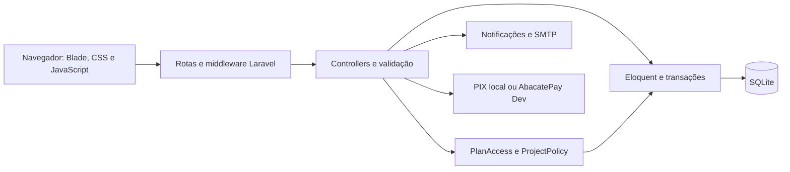

# Escopo Fácil — documentação do projeto

**Estado documentado:** 24 de outubro de 2026. As versões abaixo foram consultadas nos arquivos de dependências deste repositório.

## 1. O que é o projeto

O Escopo Fácil é uma aplicação web acadêmica para organizar projetos, tarefas e equipes. Foi desenvolvido no contexto do curso de **Tecnologia em Sistemas para Internet do Centro Universitário Senac**, com participação de **Natan Oliveira, Guilherme Augusto e Nicollas Ramos**.

O objetivo é oferecer uma interface simples para acompanhar entregas em um quadro Kanban, compartilhar projetos e controlar o acesso a funcionalidades por plano. O projeto reúne um site de apresentação, autenticação, um sistema interno e uma área administrativa.

O ambiente atual é de demonstração: os pagamentos são simulados, os ícones sociais não possuem links e o contato por WhatsApp usa um número demonstrativo enquanto uma URL real não é configurada.

## 2. O que foi implementado

### Site de apresentação

- Landing page responsiva com apresentação do produto, funcionalidades, benefícios, planos, contato e equipe.
- Identidade visual com vinho, azul, tons claros, logo do projeto, imagens e quatro nuvens decorativas.
- Header fixo com alteração de aparência ao rolar e links alinhados às seções.
- Rolagem nativa do navegador; navegação por âncoras com deslocamento suave e compensação do header.
- Entradas dos blocos padronizadas em opacidade e deslocamento vertical, repetidas quando os blocos saem e voltam à tela.
- Animações específicas da apresentação do dashboard, nuvens, troca entre celular/tablet e ilustrações dos recursos.
- Footer com navegação, suporte, documentos legais, identificação acadêmica, selo ilustrativo de privacidade e ícones de Instagram, Facebook, LinkedIn e YouTube.
- Formulário de contato com validação no servidor, envio por e-mail e limite de requisições.

### Conta e autenticação

- Cadastro com nome, e-mail, cargo, senha, confirmação e aceite da versão dos termos.
- Login, logout, recuperação/redefinição de senha e confirmação de endereço de e-mail.
- Modais compartilhados com fundo desfocado sobre a landing page, usando `fetch` e History API.
- Continuação do checkout após login, cadastro e confirmação de e-mail.
- Animação de carregamento na entrada do sistema.
- Perfil com edição de dados pessoais, senha e avatar com ícone/cor.
- Exclusão de conta com confirmação de senha em uma janela aberta após o clique.

**A confirmação de e-mail não é um segundo fator de autenticação a cada login.** Não há autenticação por aplicativo TOTP implementada nesta etapa.

### Sistema interno

- Dashboard com projetos ativos, tarefas pendentes, percentual de conclusão, atividades recentes e gráficos.
- Projetos com título, descrição, proprietário, membros e estado de arquivamento.
- Tarefas em **A Fazer**, **Em Andamento** e **Concluído**, com movimentação de cartões.
- Busca, descrição e checklist por tarefa.
- Prioridades, prazos, relatórios, histórico e permissões conforme o plano.
- Painel visual que distingue funcionalidades disponíveis e bloqueadas.
- Identificação do plano na sidebar; administradores recebem o rótulo discreto **Admin**.
- Notificações internas persistentes, lista no sino e indicador vermelho apenas enquanto houver notificações não visualizadas.

### Administração

- Dashboard com usuários, confirmação de e-mail, plano efetivo, sessões válidas e presença estimada.
- Contadores de projetos, tarefas, logins e uso autenticado; gráficos diários dos últimos 14 dias.
- Indicadores separados de assinaturas, pagamentos confirmados e volume financeiro simulado.
- Gestão de assinaturas com plano, validade e busca por nome ou e-mail, preservada na paginação.
- Listagem, criação e edição de planos, preços mensais/anuais e limites.
- Restrição de exclusão de planos utilizados.
- Acesso exclusivamente administrativo, verificado no servidor e na navegação.

## 3. Linguagens, formatos e tecnologias

### Linguagens e formatos

| Tecnologia | Aplicação |
| --- | --- |
| PHP | Backend, controllers, models, policies, commands, migrations e testes. |
| JavaScript | Modais, formulários, notificações, Kanban, comportamento da interface e ferramentas de revisão. |
| JSX | Componentes React de animação da landing page. |
| HTML e Blade | Estrutura das páginas e componentes renderizados pelo Laravel. |
| CSS | Layout, identidade visual, responsividade, transições e animações. |
| SQL / SQLite | Persistência relacional, consultas e agregações. |
| JSON | Configuração de pacotes e comunicação entre navegador e servidor. |
| Markdown | README e documentação técnica. |
| SVG, PNG, JPEG, WebP e WebM | Ícones, logos, imagens e vídeo de carregamento. SVG é usado como formato gráfico, não como framework. |

Python e PowerShell foram utilizados como ferramentas auxiliares de desenvolvimento/revisão. Não são necessários para executar a aplicação Laravel.

### Backend e ferramentas PHP

| Dependência | Versão no lockfile | Função |
| --- | --- | --- |
| PHP | Requisito declarado: `^8.2`; ambiente utilizado: 8.3 | Execução da aplicação. |
| Laravel | 12.69.3 | Framework web, rotas, validação, ORM, autenticação, sessões, migrations, notificações e agendamento. |
| Laravel Breeze | 2.4.2 | Base de autenticação/perfil posteriormente adaptada ao design do projeto. |
| Laravel Tinker | 2.11.1 | Console interativo para manutenção/desenvolvimento. |
| Symfony Mailer | 7.4.19, transitivo do Laravel | Transporte de e-mail SMTP. |
| PHPUnit | 11.5.56 | Testes automatizados. |
| Faker | 1.24.1 | Geração de dados de teste. |
| Mockery | 1.6.15 | Dublês de teste. |
| Collision | 8.9.5 | Apresentação de erros e testes no terminal. |
| Laravel Pint | 1.30.4 | Ferramenta de formatação disponível no desenvolvimento. |
| Laravel Pail | 1.2.7 | Leitura de logs durante o desenvolvimento. |
| Laravel Sail | 1.68.0 | Ferramenta opcional de ambiente Docker; não é exigida pelo fluxo local documentado. |

Eloquent, Blade, Artisan, Carbon, Hash, Gate e as notificações de banco são recursos utilizados pelo Laravel e suas dependências. A lista completa de dependências transitivas e suas licenças está em `composer.lock`.

### Frontend e ferramentas Node.js

| Dependência | Versão no lockfile | Função |
| --- | --- | --- |
| React / React DOM | 19.3.1 | Componentes e montagem das animações da landing page. |
| Motion | 14.4.0 | Animações React, valores de scroll, springs e transições. |
| QRCode | 1.5.4 | Renderização local do QR Code do checkout em canvas. |
| Vite | 7.3.6 | Servidor de desenvolvimento e compilação dos assets. |
| Laravel Vite Plugin | 2.1.0 | Integração do Vite com os templates Laravel. |
| Tailwind CSS | 3.4.19 | Estilos das telas/componentes de base herdados do Breeze. |
| Tailwind Forms | 0.5.11 | Estilização de formulários da base Tailwind. |
| Alpine.js | 3.17.4 | Interações dos componentes da base Breeze. |
| Axios | 1.20.0 | Cliente HTTP inicializado na estrutura JavaScript base; os fluxos personalizados usam principalmente `fetch`. |
| PostCSS / Autoprefixer | 8.5.28 / 10.6.1 | Processamento do CSS no build. |
| Concurrently | 9.2.4 | Execução simultânea dos processos do script `composer dev`. |
| `@tailwindcss/vite` | 4.3.3 | Presente nas dependências; não está registrado como plugin no `vite.config.js` atual. |
| Chart.js | 4.4.8, carregado por CDN | Gráficos do dashboard do usuário. Os gráficos administrativos usam HTML/CSS. |

As páginas próprias do site e do sistema usam principalmente CSS personalizado. A aplicação não utiliza exclusivamente Tailwind nem renderiza todas as telas em React. As fontes incluem Open Runde na landing page e Outfit no sistema; os arquivos locais e os imports podem ser consultados nos CSS correspondentes.

`package.json` declara os intervalos aceitos; `package-lock.json` registra as versões resolvidas. `composer.json` e `composer.lock` cumprem os mesmos papéis no PHP.

### Serviços e ferramentas de ambiente

- **SQLite:** banco utilizado no ambiente atual, por meio de PDO/Eloquent.
- **SMTP:** transporte de mensagens de confirmação, recuperação e contato. Foi validado com Gmail usando senha de aplicativo.
- **AbacatePay:** integração opcional com a API v2 em modo de desenvolvimento para criar, consultar e simular PIX.
- **Mailpit:** caixa SMTP local opcional para capturar mensagens durante testes.
- **Laragon:** ambiente Windows utilizado no desenvolvimento, sem ser requisito obrigatório.
- **Git e GitHub:** versionamento e hospedagem do repositório.
- **Chrome DevTools Protocol:** ferramenta de revisão de interface no navegador. Os scripts auxiliares locais ficam em `.preview`, que é ignorada pelo Git.

## 4. Arquitetura

A aplicação é um **monólito Laravel com frontend híbrido**. O servidor renderiza páginas Blade. JavaScript adiciona comportamento assíncrono, e React é utilizado em partes específicas da landing page. Os modais funcionam sem recarregar a página, mas a navegação geral do sistema continua baseada em rotas Laravel; não se trata de uma SPA React integral.



### Responsabilidades principais

| Arquivo / diretório | Responsabilidade |
| --- | --- |
| `routes/web.php`, `routes/auth.php` | Rotas públicas, autenticação, sistema, checkout e administração. |
| `SystemController` | Prepara os dados do dashboard, projetos, tarefas e configurações para as telas originais. |
| `WorkspaceController` | Operações autorizadas de projetos, tarefas, membros, checklists, relatórios e histórico. |
| `SystemActionController` | Traduz os payloads da interface legada para as operações do backend Laravel. |
| `PlanAccess` | Resolve o plano válido, suas funcionalidades e limites. |
| `ProjectPolicy` | Verifica propriedade e papéis de acesso a projetos. |
| `SubscriptionController`, `AbacatePix` | Checkout, pedidos PIX, consulta, simulação e ativação de assinatura. |
| `Admin/*Controller` | Indicadores administrativos, catálogo de planos e gestão de assinantes. |
| `NotificationController` | Consulta e marcação das notificações da conta autenticada. |
| `UsageMetrics`, `TrackSystemActivity` | Contadores diários e última atividade. |
| `SystemAvatar` | Validação e apresentação dos avatares. |
| `resources/views` | Páginas e componentes Blade. |
| `resources/js` | Entradas compiladas pelo Vite, incluindo landing e checkout. |
| `public/assets/landing`, `public/system/assets` | Recursos visuais, CSS e scripts próprios do site e do sistema. |
| `database/migrations`, `database/seeders` | Evolução do schema e dados iniciais do catálogo. |
| `tests` | Suíte automatizada PHP. |

## 5. Planos, assinaturas e permissões

Os planos se diferenciam por funcionalidades. Por padrão, todos permitem **projetos e membros ilimitados**. A administração pode configurar cotas numéricas; `-1` significa ilimitado. Nos primeiros **sete dias contados da criação da conta**, o Free libera todos os recursos de Pro e Equipe, sem conceder administração. Ao vencer o teste, a conta continua utilizável no Free; apenas as funcionalidades pagas são bloqueadas, sem apagar dados ou reiniciar o prazo em novos logins.

O resumo **Seu plano** fica em **Configuração**, com a validade do teste quando ativo. Após o teste, controles pagos aparecem desabilitados com cadeados cinza. O card **Acesse nosso site** da lateral aparece somente para contas comuns Free. A matriz abaixo descreve o Free após o teste completo:

| Funcionalidade | Free | Escopo Pro | Equipe |
| --- | --- | --- | --- |
| Projetos, tarefas por status, membros e busca | Sim | Sim | Sim |
| Checklist | Sim | Sim | Sim |
| Prioridades e prazos | Não | Sim | Sim |
| Relatório do projeto | Não | Sim | Sim |
| Papéis avançados de membros | Não | Não | Sim |
| Histórico de tarefas | Não | Não | Sim |
| Relatório completo, prioridades e atrasos | Não | Não | Sim |
| Recurso de suporte da equipe | Não | Não | Sim |

O canal de suporte informa contato e horário; não representa uma central externa de atendimento implementada.

As regras estão em `config/entitlements.php`. Para conceder recursos pagos, `PlanAccess` exige uma assinatura ativa, reconhecida e ainda válida. Alterar apenas `users.plan_id` não libera um plano pago. Na ausência de assinatura válida, o plano efetivo volta ao Free.

Nos projetos compartilhados, as funcionalidades seguem o **plano do proprietário**. O papel do participante limita suas ações:

- **Proprietário:** administra o projeto e nomeia/remove gestores.
- **Gestor:** gerencia o projeto e membros dentro das permissões de Equipe; não substitui o proprietário.
- **Membro:** pode colaborar nas tarefas conforme as regras do projeto.
- **Leitor:** consulta, sem editar tarefas/checklists, inclusive se o plano do projeto perder recursos pagos.

O perfil administrativo `is_admin` é independente do plano comercial. Ele libera a administração, não uma assinatura pessoal automática.

## 6. Fluxos principais

### Cadastro e confirmação

O cadastro valida os campos, registra a versão dos documentos aceitos, atribui o Free e autentica a sessão. Uma notificação envia o link assinado para confirmar o e-mail. As áreas protegidas exigem confirmação. Links inválidos ou expirados apresentam a tela correspondente; o usuário pode solicitar reenvio.

### Compra e ativação

Pro e Equipe abrem o mesmo componente de pagamento, preservando plano e período durante a autenticação. O servidor consulta o catálogo e determina o valor; não aceita um preço enviado pelo navegador como fonte de verdade.

Valores iniciais do seeder:

| Plano | Mensal | Anual |
| --- | --- | --- |
| Free | R$ 0,00 | R$ 0,00 |
| Escopo Pro | R$ 27,90 | R$ 238,80 |
| Equipe | R$ 49,90 | R$ 499,00 |

O site apresenta o Pro anual também como equivalente de R$ 19,90 por mês. O catálogo administrativo pode ser alterado; `PlanSeeder` preserva planos existentes. O Equipe exibido na landing consulta o catálogo; os textos/preços estáticos do Pro na landing também devem ser revisados se o catálogo for alterado.

O pedido PIX persiste o valor em centavos, plano, período, usuário e validade. **Gerar um QR Code não ativa o plano.** Somente a confirmação da simulação cria a assinatura, substitui a anterior e atualiza o plano. Confirmações repetidas do mesmo pedido não duplicam a ativação. A expiração do QR Code é de 15 minutos.

Com `PIX_DRIVER=local`, o conteúdo do QR Code é demonstrativo e não é um PIX bancário. Com `PIX_DRIVER=abacate`, o backend exige chave `dev_` e valida os dados recebidos. O checkout fica restrito a `local/testing`, sem cartão, renovação automática, cobrança real ou webhook implementado.

### Notificações

O sino consulta até 30 notificações recentes da própria conta. A bolinha representa a contagem total não visualizada. A leitura é persistida apenas para os itens visualizados na lista aberta. O estado permanece ao navegar ou recarregar. Com a lista fechada e a aba visível, a contagem é consultada a cada minuto; não há WebSocket.

O comando de teste envia somente uma notificação interna ao banco. Eventos automáticos de negócio, como avisos de prazo ou convite recebido, ainda precisam ser conectados a essa infraestrutura quando forem definidos.

### Métricas e sessões

Logins e requisições autenticadas bem-sucedidas são agregados por usuário/dia. A presença é estimada pela tabela `sessions`, com atividade recente nos últimos cinco minutos. Uma sessão válida pode estar ociosa; fechar uma aba não informa logout imediato ao servidor. Os contadores começam na instalação e não representam histórico anterior. Métricas de uso não são monitoramento de CPU/RAM.

## 7. Banco de dados

| Tabela | Conteúdo e relações principais |
| --- | --- |
| `users` | Conta, confirmação, cargo, aceite, avatar, `is_admin`, `is_demo` e referência ao plano. |
| `plans` | Slug, nome, descrição, preços e limites. |
| `subscriptions` | Usuário, plano, status e validade. |
| `pix_payments` | Pedido PIX, valor imutável em centavos, driver, código, status e confirmação. |
| `projects` | Projeto pertencente a um usuário. |
| `project_members` | Participantes e seus papéis no projeto. |
| `tasks` | Tarefas do projeto, autoria, status, prioridade e prazo. |
| `checklist_items` | Itens e conclusão por tarefa. |
| `task_events` | Histórico de alterações ligado ao projeto/tarefa. |
| `notifications` | Notificações de banco do Laravel e data de leitura. |
| `usage_metrics` | Requisições, logins e última atividade por usuário/dia. |
| `sessions`, `password_reset_tokens` | Sessões e recuperação de senha. |
| Tabelas de cache/fila | Estrutura padrão Laravel para os drivers configurados. |

Migrations, chaves estrangeiras, validações de relacionamento e transações mantêm os vínculos. A exclusão da conta remove seus projetos e participações; a autoria em tarefas de terceiros pode ficar nula. As notificações da conta também são removidas.

## 8. Rotas de referência

| Área | Rotas |
| --- | --- |
| Site / contato | `/`, `/contato`, `/plans` |
| Documentos | `/termos-de-uso`, `/privacidade` |
| Conta | `/login`, `/register`, `/forgot-password`, `/reset-password/{token}`, `/verify-email`, `/profile` |
| Sistema | `/dashboard`, `/projects`, `/projects/{project}` |
| Operações | `/projects/{project}/tasks`, `/members`, `/report`, `/history` e rotas aninhadas de checklist |
| Recursos do plano | `/account/entitlements`, `/account/team-support` |
| Pagamento | `/assinar/pro`, `/assinar/equipe`, `/checkout/options/{slug}`, `/checkout/process`, `/payments/{payment}` |
| Administração | `/admin`, `/admin/subscribers`, `/admin/plans` |
| Notificações | `GET /notifications`, `POST /notifications/read` |
| Compatibilidade da interface original | `/system/index.php` e `/system/actions/{group}/{action}.php` |

As URLs de compatibilidade são processadas pelo Laravel; não executam arquivos PHP públicos do sistema antigo. A interface e as respostas JSON compartilham as mesmas regras de autorização. A listagem completa, com métodos e middleware, está disponível com `php artisan route:list`.

## 9. Instalação local

### Requisitos

- PHP compatível com `composer.json`, Composer e extensões exigidas pelo Laravel, incluindo PDO SQLite para este ambiente.
- Node.js **20.19+ ou 22.12+**, conforme os requisitos do Vite instalado, e npm.
- Diretórios `storage` e `bootstrap/cache` graváveis pelo processo PHP.
- SMTP válido para entregar e-mails externos; Mailpit é uma alternativa local.

### Primeiro uso

Execute na raiz de uma instalação nova:

```sh
composer install
php -r "file_exists('.env') || copy('.env.example', '.env');"
php artisan key:generate
php -r "file_exists('database/database.sqlite') || touch('database/database.sqlite');"
php artisan migrate --seed
npm ci
npm run build
php artisan serve
```

Configure no `.env` a URL usada para acessar o site, por exemplo `APP_URL=http://127.0.0.1:8000`. Esse endereço também participa dos links enviados por e-mail. A chave deve ser gerada no primeiro preparo; não regenere a `APP_KEY` de um ambiente já em uso.

Para desenvolvimento de frontend, execute `npm run dev` em outro terminal, mantendo o servidor PHP ativo. O script `composer dev` também está disponível e inicia servidor, listener de fila, logs e Vite. Dependendo das ferramentas PHP disponíveis no Windows, prefira os processos separados.

### SMTP e personalização de e-mail

Exemplo genérico para Gmail:

```dotenv
MAIL_MAILER=smtp
MAIL_SCHEME=smtp
MAIL_REQUIRE_TLS=true
MAIL_HOST=smtp.gmail.com
MAIL_PORT=587
MAIL_USERNAME=sua-conta@gmail.com
MAIL_PASSWORD="sua senha de aplicativo"
MAIL_FROM_ADDRESS=sua-conta@gmail.com
MAIL_FROM_NAME="Escopo Fácil"
```

Use uma senha de aplicativo pertencente à conta autenticada. A conta escolhida para envio, respostas e suporte é `escopofacil@gmail.com`, exibida como Escopo Fácil. Valores com espaços precisam de aspas no `.env`. A conta e sua senha de aplicativo precisam ser configuradas no Google e nas variáveis privadas da hospedagem.

Após mudar a configuração, execute `php artisan config:clear` e reinicie processos persistentes. O HTML do e-mail está em `resources/views/emails/auth.blade.php`; assunto, textos e botões são definidos em `app/Providers/AppServiceProvider.php`.

Para Mailpit local: host `127.0.0.1`, porta `1025`, usuário/senha vazios e `MAIL_REQUIRE_TLS=false`. Ele captura mensagens localmente, sem entregá-las pela Internet. `MAIL_MAILER=log` registra o conteúdo no log, também sem entrega externa.

### Administração, exemplos e manutenção

```sh
php artisan dev:create-admin
php artisan dev:plan-demos
php artisan dev:notification
php artisan mail:test-smtp destinatario@example.com
php artisan mail:test-verification conta-nao-confirmada@example.com
php artisan subscriptions:expire
```

O administrador de desenvolvimento usa `DEV_ADMIN_EMAIL` e `DEV_ADMIN_PASSWORD`; sem senha configurada, o comando gera uma aleatória. Esses comandos de criação/teste ficam restritos ao ambiente local/testing. Contas existentes não recebem redefinição automática de senha.

`user:admin {email}` promove uma conta existente; `--revoke` revoga a administração. É uma operação de manutenção no servidor e não uma ação pública do site.

`subscriptions:expire` está agendado a cada hora. Para executar o scheduler localmente, use `php artisan schedule:work`. A autorização verifica a validade a cada requisição e não depende exclusivamente desse comando.

O roteiro e as credenciais públicas **somente de demonstração** estão em [contas-demonstracao.md](contas-demonstracao.md). O banco local e as contas criadas por esses comandos não são enviados ao GitHub; cada instalação deve executar suas migrations e comandos de preparo.

## 10. Segurança e privacidade implementadas

- Sessão Laravel, regeneração no login e invalidação no logout.
- Senhas com hashing, proteção CSRF e validação no servidor.
- Confirmação de e-mail por link assinado e com expiração.
- Limites de requisições em autenticação, recuperação, contato e pagamentos.
- Middleware `auth`, `verified`, `subscription` e `admin`, conforme a rota.
- Policies por projeto; validação de IDs aninhados contra acesso a dados de outras contas.
- Recursos pagos verificados no servidor e independentes dos controles visuais.
- Preço calculado no servidor e ativação idempotente da assinatura.
- Notificações consultadas/marcadas exclusivamente no escopo da conta autenticada.
- Avatares limitados a cores e ícones válidos, sem aceitar caminhos arbitrários.
- Templates com escape e inserção de texto no DOM sem transformar conteúdo de notificações em HTML.
- Versionamento do aceite de termos e aviso de privacidade.

O `.env`, bancos SQLite, dependências instaladas, builds gerados e arquivos de revisão são ignorados pelo Git. O selo LGPD é informativo e não representa certificação. Os documentos descrevem o contexto acadêmico; devem ser revisados quando as práticas reais do projeto mudarem.

## 11. Testes e validação

```sh
php artisan test
npm run build
```

A última execução da suíte nesta etapa teve **117 testes e 719 asserções aprovados**. Essa contagem é um retrato da versão documentada, não um indicador de CI automático.

Os testes cobrem autenticação, confirmação/recuperação, documentos, contato, checkout, preços do servidor, ativação de Pro/Equipe, expiração, papéis, limites, manipulação de IDs, administração, demonstrações e notificações. Usam banco SQLite em memória e dublês de serviços externos quando apropriado.

Também foram realizadas revisões no Chrome para modais, Kanban, rolagem, animações, sidebar em várias alturas, diferenças visuais dos planos e leitura persistente de notificações. O SMTP foi testado com captura local e envio externo, com recebimento confirmado pelo responsável. A integração externa AbacatePay necessita de chave Dev válida para validação real no provedor; os testes HTTP automatizados não equivalem a uma compra bancária.

## 12. Histórico da integração com o projeto antigo

O diretório `Sistema` (anteriormente chamado `backup_antigo`) preserva a versão original, baseada em PHP, sessões próprias, PDO e MySQL. Foram reutilizados o visual e as interações de dashboard, projetos, tarefas, perfil, avatares e modais.

Na aplicação atual, essas telas foram adaptadas para Blade e Eloquent. A autenticação e a autorização são do Laravel; os assets reaproveitados estão em `public/system/assets`. Não houve importação automática de usuários, senhas ou dados MySQL antigos. O banco do sistema novo foi preparado por migrations.

O mailer antigo usava `mail()` nativo e mensagens em texto simples. O envio atual usa notificações Laravel, HTML personalizado e SMTP.

## 13. Limites atuais e continuidade

- Checkout limitado à simulação acadêmica; pagamentos de produção, webhook, estorno e cobrança recorrente não estão implementados.
- Confirmação de e-mail disponível; 2FA por segundo fator a cada login não implementado.
- Contatos públicos e links sociais incluem elementos demonstrativos; o domínio de suporte deve ser provisionado antes de usá-lo como remetente real.
- Presença estimada por atividade, sem conexão em tempo real por WebSocket.
- Notificações persistentes prontas; novos gatilhos de negócio ainda devem ser especificados.
- Catálogo de funcionalidades definido em configuração, sem editor visual de permissões por recurso.
- O histórico registra alterações de tarefas; não é uma auditoria geral de todas as operações do sistema.
- O botão de suporte não integra automaticamente uma plataforma externa de atendimento.
- Parte do catálogo textual/preço na landing ainda é estática, conforme descrito na seção de planos.
- Chart.js e a fonte Outfit do sistema usam recursos externos; seu carregamento depende de conectividade.

Para publicação, preparar domínio/HTTPS, `APP_URL`, servidor apontando para `public`, banco, SMTP, scheduler, assets compilados e configurações do ambiente. O checkout simulado permanece bloqueado em produção pelo código atual. Não habilitar pagamentos reais apenas substituindo uma chave.

## 14. Índice dos documentos complementares

- [Autenticação e modais](autenticacao.md)
- [Backend, planos e autorização](backend-planos.md)
- [PIX acadêmico](pagamentos-pix.md)
- [Sistema, administração e e-mail](sistema-admin-email.md)
- [Contas e roteiro de demonstração](contas-demonstracao.md)
- [Documentos legais](documentos-legais.md)

Os metadados do esqueleto em `composer.json` ainda identificam o pacote como `laravel/laravel`. Eles não substituem a identificação acadêmica deste documento. Dependências, marcas, fontes e recursos de terceiros mantêm suas respectivas licenças; este documento não atribui uma nova licença ao conjunto do projeto.
